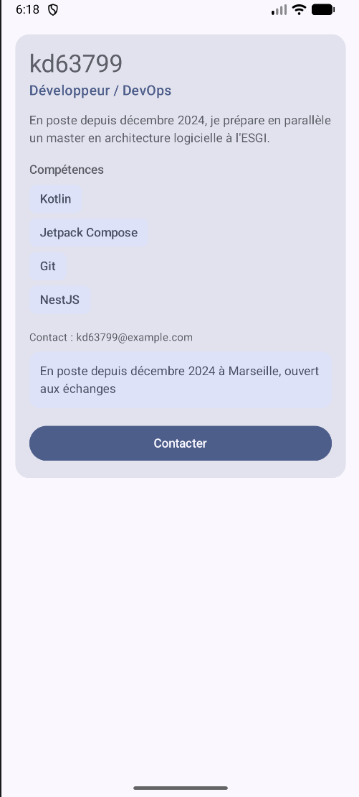

# Profil développeur Compose

## Description

Une application Android avec une seule fiche de profil développeur.
On y voit un nom, un rôle, une description, des compétences, un contact et une disponibilité.
Il y a deux actions : une zone cliquable pour la disponibilité et un bouton « Contacter ». Pour l'instant elles ne font rien.
Tout le code est dans `MainActivity.kt`.

## Notions utilisées

- composables et paramètres
- modifiers (chaînage, padding externe / interne)
- callbacks
- accessibilité de base
- previews

## Explication courte

1. **Composables créés** : `ProfilScreen`, `ProfileCard`, `ProfileHeader`, `SkillTag`, `InfoLine`, `AvailabilityZone`, `ContactButton`.
2. **Écran principal** : `ProfilScreen`.
3. **Padding externe** : dans `ProfilScreen`, sur `ProfileCard` (`Modifier.padding(16.dp)`), et avec le `innerPadding` du `Scaffold`.
4. **Padding interne** : dans `ProfileCard`, sur la `Column` qui contient le contenu, et dans `SkillTag` et `AvailabilityZone`.
5. **Callback** : `ContactButton` et `AvailabilityZone` reçoivent un `onClick`. Dans `MainActivity` il est vide.
6. **Accessibilité** : `AvailabilityZone` est une zone cliquable que j'ai faite moi-même, donc j'ai mis `Role.Button` et un `contentDescription` pour le lecteur d'écran. Le `Button` de `ContactButton` n'en a pas besoin : il est déjà annoncé comme un bouton avec son texte.
7. **Réutilisables** : ils reçoivent leurs données en paramètres et acceptent un `modifier`. `SkillTag` sert pour chaque compétence, et les deux previews utilisent les mêmes composables avec des données différentes.

## Capture

